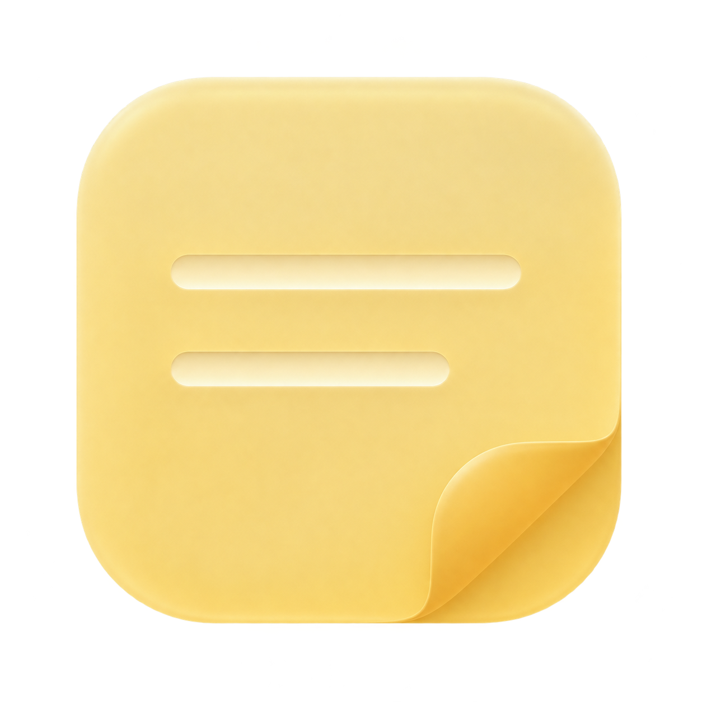

# tagme

A compact Windows desktop widget for notes, checklists, images, attachments, and saved AI Markdown. Pale yellow frosted glass, rounded controls, and an unobtrusive tray presence.

## Install

Download `tagme-Setup.exe` from the [GitHub release](https://github.com/Oraik-LLP/widget-notes/releases/tag/tagme-1.6.1) and run it. Per-user setup includes notebook file registration and an uninstaller, with optional desktop shortcut and launch-at-sign-in tasks. The self-contained app needs no separately installed .NET runtime. The installer is unsigned; its SHA-256 is included with the release.

Upgrading from WidgetNotes keeps existing notebooks and preferences in `Documents/WidgetNotes` and `%LOCALAPPDATA%/WidgetNotes`. These internal storage names are retained for compatibility. Setup replaces the startup registration and retargets existing shortcuts.

## Use

Ctrl+Alt+N shows or hides the widget. Add lists, notes, images or attachments from the toolbar. Import or drop local Markdown exported from GPT, Claude, Gemini, Antigravity or other agents. Markdown checkboxes become editable tasks. This imports local files; it does not connect to AI accounts.

Drag the header to move and the edges to resize. Blur and content layout pause during the gesture, then restore after release. Lock prevents accidental movement. Closing hides to the tray; the menu's Exit saves and quits.

## Brand

The chosen mark is a butter-yellow frosted sticky note with an amber folded corner and two ivory note strokes. Palette: butter `#F6D96B`, cream `#FFF6CE`, amber `#DBA93A`. Alternatives: a rounded glass tag, or a folded ribbon forming a lowercase t. Use the sticky-note mark for the app icon and lowercase `tagme` for the wordmark.

## Build

Run `./build.ps1` with .NET 10 SDK on Windows x64. The output is `dist/package/tagme.exe` and `dist/tagme-Windows-x64.zip`. The build creates a multi-size ICO from the supplied PNG.

Diagnostics: `--self-test`, `--ui-test`, or `--application-test` with a separate `--test-root=...`. Run desktop diagnostics under an interactive signed-in Windows user. `--material-preview` with an isolated test root verifies the compositor against a temporary animated backdrop.

Native Acrylic uses [WPF UI](https://github.com/lepoco/wpfui); its MIT licenses and dependency notices are included. The glass appearance is maintained while unfocused; movement suspends it without rebuilding the window frame. This is Windows frosted Acrylic, not a React refraction shader.

GitHub Actions builds, checks and packages Windows releases. Push a version tag to publish the ZIP. The executable is unsigned.
